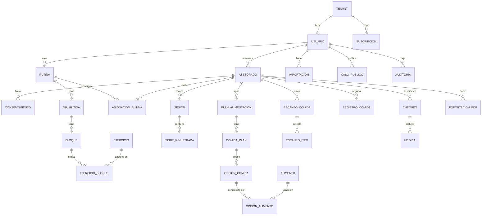

# Modelo de datos

Punto de partida aprobado. Se puede ajustar al implementar; cualquier cambio se anota en la Bitácora técnica de Notion.

## Campos clave

- **TENANT:** id, nombre, plan, logo_key, color, nombre del equipo.
- **USUARIO:** id, tenant_id, correo, rol (ENTRENADOR, ASESORADO, ADMIN), foto_key (opcional).
- **ASESORADO:** id, tenant_id, usuario_id, entrenador_id, objetivo, consideraciones (lesiones), sexo para la técnica (hombre o mujer), estado.
- **CONSENTIMIENTO:** asesorado_id, tipo (DATOS_PERSONALES, SALUD, FOTOS_IA), version_texto, firmado_en, revocado_en.
- **EJERCICIO:** tenant_id (nulo si es de la base global de Fuertia), nombre, disciplina, músculos, material, `se_registra` (PESO_REPS, TIEMPO, DISTANCIA_RITMO, RONDAS), pasos, errores comunes, medios (video o fotos), rango mostrado.
- **BLOQUE:** tipo (CALENTAMIENTO, FUERZA, METCON, ESTACIONES, CARRERA, TECNICA, ENFRIAMIENTO), orden.
- **EJERCICIO_BLOQUE:** prescripción (series, reps, carga, RPE, descanso, distancia, ritmo, tiempo, rondas), notas.
- **SERIE_REGISTRADA:** sesion_id, ejercicio_id, los valores según `se_registra`, esfuerzo.
- **ALIMENTO:** tenant_id (nulo si es global), nombre, fuente (USDA, ICBF, PROPIO, OFF), kcal, proteína, carbohidratos y grasa por 100 g, estado de cocción de referencia (crudo o cocido).
- **ESCANEO_COMIDA:** foto_key, estado, proveedor_ia, modelo, costo_usd, respuesta_cruda, creado_en.
- **ESCANEO_ITEM:** alimento_id, nombre_detectado, gramos_estimados, gramos_confirmados, confianza, corregido.
- **MEDIDA:** chequeo_id, tipo, valor, unidad. Las medidas van en filas, no en columnas, para sumar tipos sin migrar la tabla. Tipos del MVP: PESO, GRASA_PCT, MASA_MUSCULAR, MASA_MAGRA, AGUA_PCT, GRASA_VISCERAL, MASA_OSEA, METABOLISMO_BASAL, EDAD_METABOLICA, PLIEGUES, CUELLO, PECHO, CINTURA, CADERA, BRAZO, MUNECA, PIERNA y PANTORRILLA. IMC y las relaciones se calculan; no se guardan.
- **EXPORTACION_PDF:** asesorado_id, secciones, desde, hasta, archivo_key, vence_en.
- **IMPORTACION:** tipo (EJERCICIOS, ALIMENTOS, RUTINAS, PLANES), archivo_key, filas válidas, filas con error, estado.
- **CASO_PUBLICO:** asesorado_id, métricas mostradas (salen de datos reales de la app), permiso_en, revocado_en.

## Reglas

- Todas las tablas de negocio llevan `tenant_id` y un filtro global lo aplica en cada consulta.
- Cifrado por columna en las medidas y en las consideraciones de salud.
- La respuesta cruda de la IA se conserva por un tiempo definido para auditar y comparar.
- Los casos públicos solo muestran datos medidos en la app y requieren permiso explícito del asesorado, que puede revocarlo.
